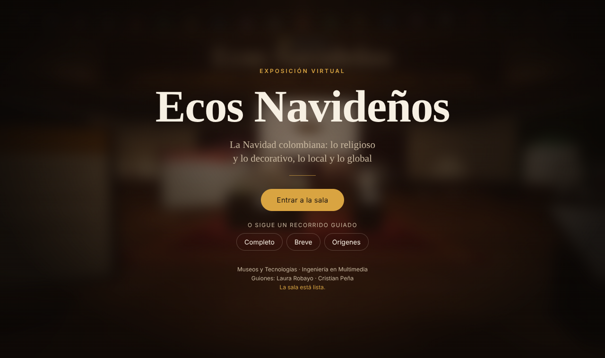

# Ecos Navideños

Exposición virtual en 3D sobre la Navidad colombiana: lo religioso y lo decorativo, lo local y lo global.

Museos y Tecnologías · Ingeniería en Multimedia
Guiones: Laura Robayo · Cristian Peña

## Cómo verla

Abre `index.html` con doble clic en cualquier navegador (Chrome, Edge, Safari o Firefox). Necesita internet para cargar Three.js y las fuentes. Descarga la carpeta completa: los modelos 3D están en `modelos/`.

Con doble clic los modelos se leen de `modelos/embebidos/` (copias en base64 sin Draco). Si cambias un `.glb`, vuelve a generarlas con `node herramientas/empaquetar_modelos.mjs` (instrucciones dentro del archivo).

- Camina con W A S D o las flechas, o haz clic en el piso.
- Arrastra para mirar.
- Haz clic en una vitrina, panel o pantalla para abrir su información.
- Cerca del pedestal "La pieza de tu familia" (Lugar E) suena un aguinaldo instrumental. El botón **Música** del menú lo apaga.

## Documentos

- `docs/Guiones_Ecos_Navidenos.pdf`: guiones de la exposición.
- `Presentacion_Ecos_Navidenos.pptx`: presentación para la sustentación. Ábrela desde esta carpeta: el botón «Abrir la exposición» abre `index.html`.
- `presentacion/Ecos_Navidenos_Guiones.pptx` y `presentacion/Ecos_Navidenos_Decisiones_de_diseno.pptx`: versiones de apoyo.

## Créditos de imágenes

Las fotografías de la pared "La pieza de tu familia" son imágenes de referencia tomadas de Pinterest (autores: Por completar), usadas con fines académicos.

